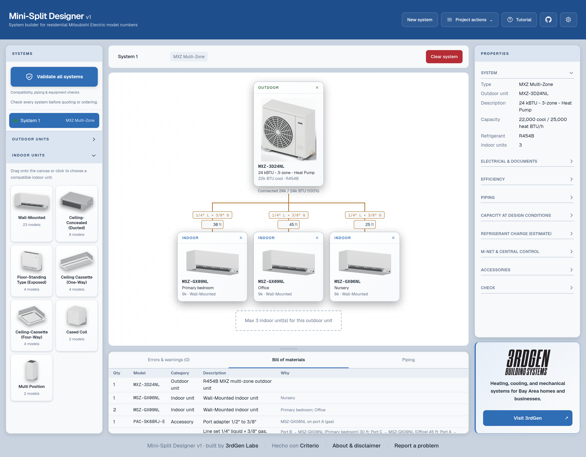

# Mini-Split Designer

Plan ductless HVAC systems using Mitsubishi Electric model numbers and put together a bill of materials in your browser. The catalog covers US-market M & S-Series, P-Series, MXZ, and single-phase Smart Multi equipment. Choose outdoor and indoor units, lay out your system, enter piping and room details, and review compatibility, controls, accessories, and estimated quantities.

**[Open Mini-Split Designer →](https://designer.3rdgen.io)**



Built for the community. Use and customize the original project work, replace or remove the branding, and integrate the designer into your own website. No payment, donation, credit, or link back is required. Original work is licensed under [MIT-0](LICENSE); see [license scope](LICENSE_SCOPE.md) for the materials covered.

**V1 community reference tool.** See [release notes and limitations](RELEASE_STATUS.md) before deploying or redistributing.

Mitsubishi Electric equipment names and model numbers are used solely to identify the referenced equipment. All trademarks belong to their respective owners. This is an independent planning and estimating tool, not affiliated with, endorsed by, or sponsored by Mitsubishi Electric, Mitsubishi Electric Trane HVAC US, or their affiliates. Verify designs against current manufacturer documentation with a qualified HVAC professional before quoting, ordering, or installing. A passing result is not manufacturer approval.

## Reference data snapshot

**Snapshot recorded: October 15, 2026.** The bundled US-market reference data reports METUS catalog database version **5.14.0.15**. This is a fixed reference snapshot; the app does not automatically receive manufacturer catalog or rule updates. Check current manufacturer submittals and installation manuals before relying on a selection.

## Run it locally

Use Node.js 24 LTS and pnpm 12 (this checkout was checked with Node 24.21.0 and pnpm 12.11.2). Clone the repository and start the app:

```sh
git clone https://github.com/3rdGen-Labs/minisplit-designer.git
cd minisplit-designer/app
pnpm install --frozen-lockfile
pnpm dev
```

Open <http://localhost:3000>. No account, API key, paid service, or Mitsubishi installation is needed for the web app. Equipment data is included; no separate database setup is required.

```sh
pnpm test       # engine and importer checks
pnpm lint       # code checks (current checkout has warnings)
pnpm build     # production build
pnpm start     # run the built server
```

The production build downloads Geist fonts from Google. Allow outbound access during the build or change `src/app/layout.tsx` to use local/system fonts.

## How the pieces work

| Component | Location | Purpose |
| --- | --- | --- |
| Designer | `app/src/components/Designer.tsx` | Equipment selection, layout, properties, issues, BOM, CSV export, and branding |
| Workspace and walkthrough | `app/src/components/DesignSplit.tsx`, `GuidedTutorial.tsx` | Resizable panels and guided introduction |
| Shared types | `app/src/lib/design.ts` | Input design and evaluation output contracts |
| Catalog adapter | `app/src/lib/catalog.ts` | Reads generated JSON and normalizes model records |
| Rules engine | `app/src/lib/engine/` | Compatibility, piping, controls, accessories, charge, A2L checks, capacity estimates, and BOM |
| Evaluation API | `POST /api/evaluate` | Calls the same server-side engine used by the app |
| Project import | `POST /api/import-dsb`, `app/src/lib/dsb-import.ts` | Reads an uploaded Access-format DSB project using `mdb-reader` |
| Equipment data | `app/src/data/*.json` | Bundled equipment data used by the engine; see the release notes for its status |
| Site configuration | `app/src/lib/site.ts` | Name, logos, business card, footer credits, and path helper |
| Unit artwork | `app/public/units/` | Equipment-style illustrations; most are generated by `design/blender/units.py` |

The server builds the initial equipment palette. Browser edits go to the evaluation API, which returns issues, available choices, pipe sizes, capacity estimates, and the BOM. The UI displays those results and supports copying or exporting the BOM.

Projects and preferences are stored in browser `localStorage`, not a project database. Design details are still sent to the server for evaluation. DSB imports upload the entire selected file to the host for parsing; the route does not explicitly save it to disk, but hosting logs and infrastructure have their own policies. Avoid uploading customer information to a host you do not trust. Clearing browser storage loses saved work; projects do not synchronize between devices.

Current scope: US-market Mitsubishi M & S single-zone, P-Series, MXZ, and single-phase residential Smart Multi. Three-phase Smart Multi, VRF / City Multi, load calculations, sensible capacity, and several advanced configurations are outside the modeled scope. DSB import still needs validation against representative real project files. Inspect the response's `unchecked` list as well as its issues.

## Replace or remove the branding

Edit **`app/src/lib/site.ts`** and restart the dev server or rebuild your deployment:

- Change `name` and `owner` to your app and operator names.
- Set `header.enabled` to `false` to remove the top-left logo and its divider. Otherwise change its name, URL, and logo path.
- Set `business.enabled` to `false` to remove the bottom-right business card. Otherwise replace its name, description, URL, link label, and logo.
- Set both `credits.enabled` and `credits.secondaryEnabled` to `false` to remove the optional footer credits, or replace their text and links.

Put your logo files in `app/public/brand/` and use paths such as `/brand/your-logo.svg`. Logo paths in this configuration are local public assets; do not enter a full remote image URL. The code adds any configured site prefix automatically. Header and business logo sizes are styled in `app/src/app/globals.css` (`.labs-logo` and `.company-logo`).

Replace the install icons in `app/public/icons/` and the favicon in `app/src/app/favicon.ico` if you want your own browser/install identity. App metadata and the web manifest use `site.name`. Keep an accurate independent-tool and verification notice for your deployment; the About dialog takes the operator name from `site.owner`.

You can remove our logos from your copy. Project and business names are not a grant to imply endorsement or impersonate their owners. Third-party package license notices still apply even though our original-work license does not require attribution.

## Put it on your own website

Deploy `app/` as a Next.js application on a Node.js host or a compatible hosting platform. On Vercel, set the repository's **Root Directory to `app`**. The API routes require a server runtime, so a static-only export or GitHub Pages will not run this app by itself.

For a subdomain, deploy normally and point a domain such as `designer.example.com` at the host.

For a path such as `example.com/designer`, set this variable **when building**:

```sh
cd app
NEXT_PUBLIC_BASE_PATH=/designer pnpm build
NEXT_PUBLIC_BASE_PATH=/designer pnpm start
```

Use no trailing slash. For local development use `NEXT_PUBLIC_BASE_PATH=/designer pnpm dev`. Visit `/designer`. Change the value to another path if you prefer; omit it for the domain root. Next.js fixes `basePath` at build time, so changing the deployment setting requires a rebuild. See the [Next.js basePath documentation](https://nextjs.org/docs/app/api-reference/config/next-config-js/basePath).

Configure your existing site's reverse proxy to forward `/designer` and everything below `/designer/` to this app **with that prefix preserved**, including its API and `_next` asset requests. An ordinary link to the designer works without changing your main site's framework. An iframe is another option if your site's framing policy allows it; test its sizing and browser storage behavior on your host.

For several tools on the same origin, note that `zonespec.*` localStorage keys are shared across paths. Rename those keys consistently in `Designer.tsx`, `DesignSplit.tsx`, and `GuidedTutorial.tsx` if each copy needs separate saved projects.

The APIs currently have no application authentication or rate limiting, and evaluation input validation is minimal. Before exposing a fork to untrusted traffic, add input validation, request/body limits and resource limits at the application or hosting layer. Set a platform upload limit as well as the import route's 20 MB file limit.

## API and MCP integrations

The current checkout provides an HTTP evaluation API. A minimal request that returns an incomplete design is:

```sh
curl http://localhost:3000/api/evaluate \
  -H 'Content-Type: application/json' \
  --data '{"id":"example","name":"Example","system":"MandS","idus":[],"branchBoxes":[]}'
```

Use the `SystemDesign` and `Evaluation` types in `app/src/lib/design.ts` for full requests and responses. Numeric equipment IDs come from the deployed catalog; do not assume IDs carry across dataset replacements. Include `/designer` in the request URL when hosting under that prefix. There is no public catalog-list HTTP endpoint in this checkout.

### Connect it to Claude, ChatGPT or another AI client (MCP)

The app includes a public, read-only [MCP](https://modelcontextprotocol.io) server at `/api/mcp`. Point an MCP client at it and ask things like "will an MXZ-3D24NL run two 9k wall units on 30 and 45 ft lines, and how much refrigerant do I add?"

Server URL: **`https://designer.3rdgen.io/api/mcp`** (no key or sign-in).

- **Claude** (claude.ai or desktop): Settings → Connectors → Add custom connector → paste the URL.
- **Claude Code:** `claude mcp add --transport http minisplit-designer https://designer.3rdgen.io/api/mcp`
- **ChatGPT:** add it as a custom connector/app (developer mode) with the URL and no authentication.
- **Anything else:** any client that supports Streamable HTTP.

Tools: `list_outdoor_units`, `list_indoor_units` and `evaluate_design`. See the [MCP guide](docs/MCP.md) for details and self-hosting.

## Contributing

See [CONTRIBUTING.md](CONTRIBUTING.md). Do not contribute decompiled source, extracted manufacturer databases, installers, manufacturer artwork, credentials, or customer project files. Document the source and redistribution rights of new data and assets. Preserve dependency notices and explain substantive calculation changes with verifiable sources.
